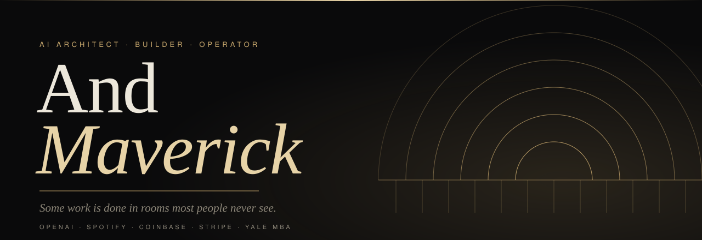
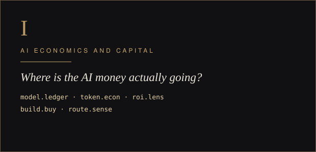
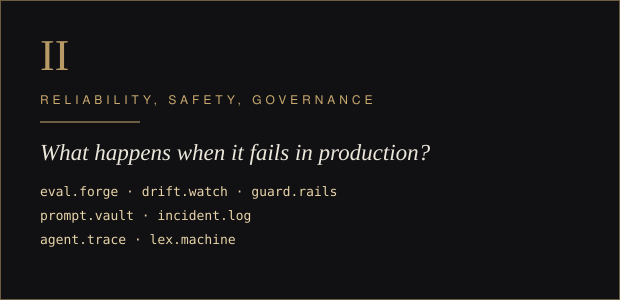
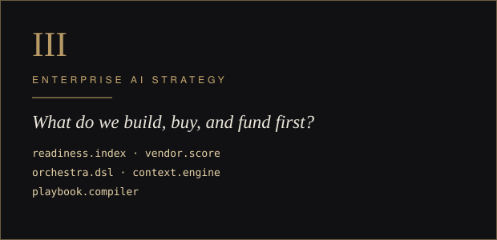
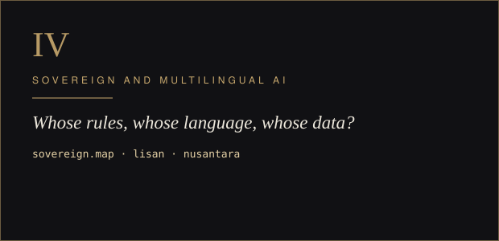
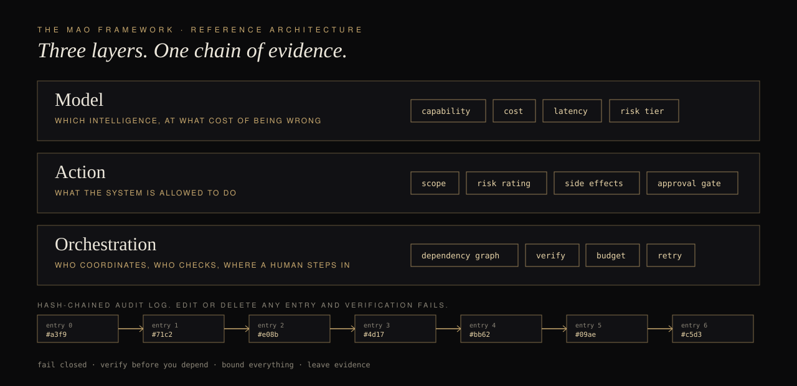

  

  <a href="https://calendly.com/andmaverick?utm_source=github&utm_medium=profile&utm_campaign=nav"><b>BEGIN A CONVERSATION</b></a> &nbsp;·&nbsp;
  <a href="https://www.andmaverick.com/mao-index?utm_source=github&utm_medium=profile&utm_campaign=nav"><b>TAKE THE FREE MAO INDEX</b></a> &nbsp;·&nbsp;
  <a href="https://blog.andmaverick.com/?utm_source=github&utm_medium=profile&utm_campaign=nav"><b>READ THE ESSAYS</b></a> &nbsp;·&nbsp;
  <a href="https://www.linkedin.com/in/andmaverick/"><b>LINKEDIN</b></a>

---

### I design the architecture behind enterprise and sovereign AI, and I lead every engagement myself.

I worked at OpenAI, led AI for product experience at Spotify for a platform serving 675 million people, advised Coinbase, and helped build infrastructure at Stripe. I'm based in Dubai and work across North America, Europe, Asia-Pacific, and the Gulf.

What follows is not a portfolio of demos. Each repository is a working, tested answer to a problem that organizations are paying real money to get wrong. Find the problem you recognize.

---

## Start with the problem you have

<table>
<tr>
<td width="50%"></td>
<td width="50%"></td>
</tr>
<tr>
<td width="50%"></td>
<td width="50%"></td>
</tr>
</table>

---

## The reference architecture

Most AI programs fail in the gaps between the model, the work it is supposed to do, and the system that coordinates both. **[mao-framework](https://github.com/AndMaverick/mao-framework)** makes those three layers explicit and testable: policy gates, verified steps, spend budgets, and a hash-chained audit log, in code anyone can read in an afternoon. It also includes a twelve-question diagnostic that finds the layer where your system will fail first.

Want the diagnostic without the code? **[Take the free MAO Index](https://www.andmaverick.com/mao-index?utm_source=github&utm_medium=profile&utm_campaign=architecture)**.

---

## The work

### I. AI economics and capital

For leaders allocating real budget to AI infrastructure. Read the thinking first: **[The Meter Is Running. Nobody Built the Architecture to Stop It.](https://blog.andmaverick.com/the-meter-is-running-nobody-built-the-architecture-to-stop-it)**

| Repository | The question it answers |
|---|---|
| [model.ledger](https://github.com/AndMaverick/model.ledger) | Which team and which model is driving the bill, and when did it spike? |
| [token.econ](https://github.com/AndMaverick/token.econ) | Does this product make money per user, and what price hits the margin we want? |
| [roi.lens](https://github.com/AndMaverick/roi.lens) | What is the ROI of this use case as a range with odds, not one hopeful number? |
| [build.buy](https://github.com/AndMaverick/build.buy) | Build or buy, over five years, at our cost of capital? |
| [route.sense](https://github.com/AndMaverick/route.sense) | Which model actually earns its cost on our traffic? |

### II. Reliability, safety, and governance

For organizations running systems whose failures have consequences. Read the thinking first: **[Nobody Signs for the Agent](https://blog.andmaverick.com/nobody-signs-for-the-agent)**

| Repository | The question it answers |
|---|---|
| [eval.forge](https://github.com/AndMaverick/eval.forge) | Did this change make the system worse, and can we block the release? |
| [drift.watch](https://github.com/AndMaverick/drift.watch) | Has the world moved away from what the model was built on? |
| [guard.rails](https://github.com/AndMaverick/guard.rails) | What is leaking out, and what is being injected in? |
| [prompt.vault](https://github.com/AndMaverick/prompt.vault) | Who changed the prompt, what changed, and can we roll it back? |
| [incident.log](https://github.com/AndMaverick/incident.log) | How severe is this failure, who owns it, and did we miss the SLA? |
| [agent.trace](https://github.com/AndMaverick/agent.trace) | Where did the agent run spend its time and money? |
| [lex.machine](https://github.com/AndMaverick/lex.machine) | Which EU AI Act, NIST AI RMF, and GDPR controls do we have evidence for? |

### III. Enterprise AI strategy

For leaders deciding what to build, what to buy, and where to invest. Read the thinking first: **[The Job Nobody Has Yet](https://blog.andmaverick.com/the-job-nobody-has-yet)**

| Repository | The question it answers |
|---|---|
| [readiness.index](https://github.com/AndMaverick/readiness.index) | How ready are we, which gap matters most, and in what order do we close them? |
| [vendor.score](https://github.com/AndMaverick/vendor.score) | Does the winning vendor survive a change in our priorities? |
| [orchestra.dsl](https://github.com/AndMaverick/orchestra.dsl) | What will this AI workflow cost, how long will it take, and where does a human approve? |
| [context.engine](https://github.com/AndMaverick/context.engine) | What belongs in the context window when the budget is fixed? |
| [playbook.compiler](https://github.com/AndMaverick/playbook.compiler) | Are our operating playbooks complete, numbered, owned, and checkable? |

### IV. Sovereign and multilingual AI

For governments, regional institutions, and businesses operating outside the assumptions built into American AI infrastructure. Read the thinking first: **[Your AI Has a Passport Problem](https://blog.andmaverick.com/your-ai-has-a-passport-problem)** and **[The Language They Did Not Build For](https://blog.andmaverick.com/the-language-they-did-not-build-for)**

| Repository | The question it answers |
|---|---|
| [sovereign.map](https://github.com/AndMaverick/sovereign.map) | Which of our AI data flows leave the jurisdictions our rules allow? |
| [lisan](https://github.com/AndMaverick/lisan) | How do we normalize Arabic text so search and models actually match it? |
| [nusantara](https://github.com/AndMaverick/nusantara) | How do we handle rupiah, Indonesian dates, phone numbers, and everyday slang in AI pipelines? |

Every repository above is dependency-free Python with a test suite and continuous integration. They are my own work and were not built for any client.

---

## The record

**Press.** The San Francisco Standard, July 2026: [Can't get an AI job? Hire someone who already has one](https://sfstandard.com/2026/07/14/ai-job-coach-industry/). The article describes me as a former product strategist at OpenAI and head of AI at Spotify.

**Conversations.** [What OpenAI, Spotify, and Coinbase Taught Me About Building AI People Actually Use](https://open.spotify.com/episode/0BfreIuQSjRs6YAEiin5qy) (Celia's Corner). [Why Your AI Strategy Is Burning Cash (And How to Fix It)](https://podcasts.apple.com/us/podcast/why-your-ai-strategy-is-burning-cash-and-how-to-fix/id1755720920?i=1000788232215) (KAJ Business and Money Live).

**Writing.** [blog.andmaverick.com](https://blog.andmaverick.com/?utm_source=github&utm_medium=profile&utm_campaign=record) on AI economics, accountability, sovereignty, and language.

**Advisory.** Selected organizations, as published at [andmaverick.com](https://www.andmaverick.com/?utm_source=github&utm_medium=profile&utm_campaign=record): Government of Australia, Government of New Zealand, Blackstone, Mayo Clinic, JPMorgan Chase, Microsoft, Suno, Temasek, G42, Sea Group.

**Fiction.** I also write. [The Looming Horizon](https://www.youtube.com/@TheLoomingHorizon) is my dystopian novel, with a companion series on YouTube.

---

## Work with me

AndMaverick works with sovereign wealth funds, governments, frontier AI companies, and enterprises. There is no team to hand you to. I lead each mandate personally.

If one of the problems above is yours, the next step is a conversation.

  <a href="https://calendly.com/andmaverick?utm_source=github&utm_medium=profile&utm_campaign=footer"><b>BEGIN A CONVERSATION</b></a> &nbsp;·&nbsp;
  <a href="https://www.andmaverick.com/mao-index?utm_source=github&utm_medium=profile&utm_campaign=footer"><b>TAKE THE FREE MAO INDEX</b></a> &nbsp;·&nbsp;
  <a href="mailto:andrew@andmaverick.com?subject=Speaking%20inquiry"><b>INQUIRE ABOUT SPEAKING</b></a>

<i>Klarheit aus Chaos.</i>

